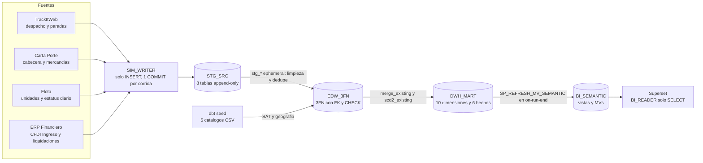
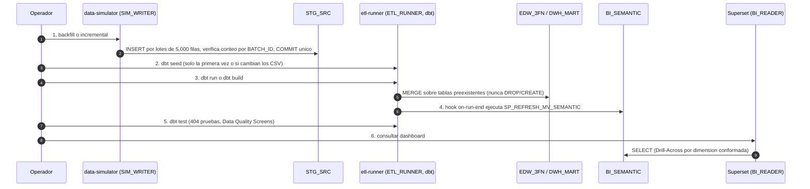
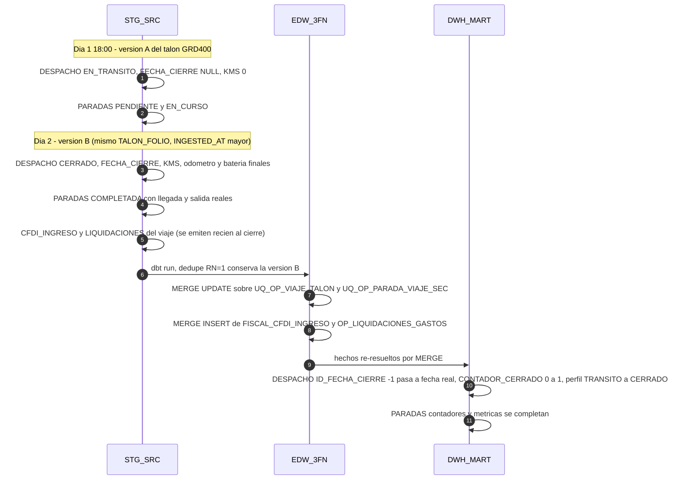

# Guía operativa — Carga de datos fuente (`STG_SRC`) para el pipeline ETL

**Proyecto:** Analytics TMS — Sunshine Deliveries
**Audiencia:** quien cargue o integre datos de TrackItWeb, Carta Porte, Flota o ERP Financiero en `STG_SRC`.
**Alcance:** qué escribir en `STG_SRC`, en qué orden, con qué formato y qué hace dbt después, para que `STG_SRC → EDW_3FN → DWH_MART → BI_SEMANTIC` termine sin errores ni descuadres.
**Fuentes de verdad (todo lo de este documento sale de ellas):**
`oracle/ddl/02_ddl_stg_src.sql`, `oracle/ddl/03_ddl_edw_3fn.sql`, `oracle/ddl/06_etl_grants.sql`, `simulator/` (contrato y generadores), `etl/dbt_tms/` (modelos, macros, seeds y tests).

> Regla de oro: **`STG_SRC` es append-only.** Un cambio posterior no se corrige con `UPDATE`; se reporta insertando una **nueva versión** de la misma llave natural con `INGESTED_AT` mayor. dbt se queda con la última versión de cada llave.

---

## 1. Flujo end-to-end

### 1.1 Diagrama



### 1.2 Secuencia de ejecución



### 1.3 Comandos

Las contraseñas viven solo en `.env` (ignorado por git). Nunca se escriben en comandos ni en archivos versionados.

```powershell
# 0. Infraestructura (Oracle debe estar healthy)
docker compose up -d oracle-dw

# 1. Carga de fuentes en STG_SRC (ejemplo con el simulador; cualquier otro cargador debe respetar este documento)
docker compose --profile sim run --rm data-simulator python -m src.main --mode backfill --days 90
docker compose --profile sim run --rm data-simulator python -m src.main --mode incremental --trips 5

# 2. Catalogos de referencia (SAT + geografia) hacia el esquema de ETL_RUNNER
docker compose --profile etl run --rm etl-runner dbt seed

# 3. Transformacion (EDW_3FN -> DWH_MART) y refresco de BI_SEMANTIC
docker compose --profile etl run --rm etl-runner dbt run

# 4. Data Quality Screens
docker compose --profile etl run --rm etl-runner dbt test

# Alternativa en un solo paso: seeds + modelos + tests en orden de dependencias
docker compose --profile etl run --rm etl-runner dbt build
```

Notas de ejecución:

| Tema | Comportamiento (verificado en `macros/refresh_semantic_layer.sql` y `dbt_project.yml`) |
|---|---|
| Refresco de MVs | `on-run-end: {{ refresh_semantic_layer() }}` ejecuta `BEGIN BI_SEMANTIC.SP_REFRESH_MV_SEMANTIC; END;` **solo** si `flags.WHICH` es `run` o `build`. `dbt test` y `dbt seed` no refrescan. |
| Primera corrida | `dbt seed` (o `dbt build`) debe ir antes que los modelos: `cat_ubicaciones`, `cat_vehiculos`, `fiscal_cartaporte_mercancias` y las tablas `SAT_*` dependen de los seeds. |
| Sin `--full-refresh` | `merge_existing` nunca hace DROP/CREATE; `--full-refresh` no tiene efecto. |
| Un solo `dbt` a la vez | Dos corridas concurrentes sobre las mismas tablas pueden chocar en los `MERGE`. Serializar las cargas. |
| Fallos en `dbt build` | dbt omite los nodos descendientes de un modelo o prueba fallida. El hook `on-run-end` de dbt se ejecuta igualmente y la macro no inspecciona resultados: tras un `build` con fallos, no tomar el dashboard como válido hasta que `dbt test` quede 100 % en verde. |

Variables de `dbt_project.yml` que limitan qué datos pueden cargarse (ver §6):

| Variable | Valor | Efecto |
|---|---|---|
| `dim_fecha_inicio` / `dim_fecha_fin` | `2026-01-01` / `2026-12-31` | Rango de `DIM_FECHA`. Una fecha fuera del rango da `-1` y rompe los tests de FK. |
| `dim_vehiculo_inicio_validez` | `2026-08-09` | Inicio de vigencia de toda unidad nueva. Un despacho anterior a esta fecha no resuelve vehículo. |
| `puntualidad_tolerancia_minutos` | `15` | Una parada es puntual si `LAG_LLEGADA_MINUTOS <= 15`. |

---

## 2. Catálogo de las 8 tablas de `STG_SRC`

### 2.1 Reglas comunes

- **Auditoría obligatoria en las 8 tablas:** `BATCH_ID VARCHAR2(64) NOT NULL`, `INGESTED_AT TIMESTAMP NOT NULL` (default `SYSTIMESTAMP`) y `SOURCE_SYSTEM VARCHAR2(30) NOT NULL`.
- **Deduplicación (todas las tablas):** `row_number() over (partition by <llave natural> order by INGESTED_AT desc, BATCH_ID desc)`, se conserva `RN = 1`. Los modelos `stg_*` son `ephemeral` (no crean objetos).
  - Si dos versiones empatan en `INGESTED_AT`, gana el `BATCH_ID` mayor **por orden de texto**. Con números de corrida de ancho fijo (`...-001`, `...-002`) el orden es correcto; `...-9` vs `...-10` no lo sería.
- **Normalización antes de comparar (`macros/staging_helpers.sql`):**
  - `clean_code` = `UPPER(TRIM(x))`: códigos y llaves (talón, ECO, operador, UUID, estatus, tipo de gasto, póliza, ubicación).
  - `clean_text` = `TRIM(x)`: textos, **sin** cambiar mayúsculas (razón social, referencia de comprobante, `BATCH_ID`).
  - `clean_rfc` = `UPPER` sin espacios.
- **Formato (contrato validado por `simulator/src/contract.py` contra el DDL):**
  - `VARCHAR2(n)` se mide en **bytes UTF-8**.
  - **Una cadena vacía no es válida:** usar `NULL`. Oracle trata `''` como `NULL`, lo que dispara `ORA-01400` en columnas `NOT NULL`.
  - `NUMBER(p,s)` respeta precisión y escala.
  - `TIMESTAMP` sin zona horaria (hora local de negocio). `DATE` solo en `FECHA_CORTE` y `VIGENCIA_POLIZA`.
  - El conjunto de columnas debe ser exactamente el del DDL.
- **Privilegios:** `SIM_WRITER` tiene `SELECT/INSERT/UPDATE` sobre `STG_SRC` (el `DELETE` se revocó en `06_etl_grants.sql`). `ETL_RUNNER` lee `STG_SRC` y escribe en `EDW_3FN` y `DWH_MART`. `BI_READER` no ve `STG_SRC`.
- **`SOURCE_SYSTEM`:** `_sources.yml` lo valida con `accepted_values`.

| Tabla | `SOURCE_SYSTEM` válido |
|---|---|
| `STG_TRACKIT_DESPACHO`, `STG_TRACKIT_PARADAS` | `TRACKITWEB` |
| `STG_CARTA_PORTE_CABECERA`, `STG_CARTA_PORTE_MERCANCIAS` | `CARTA_PORTE` |
| `STG_FLOTA_UNIDADES`, `STG_FLOTA_ESTATUS_DIARIO` | `FLOTA` |
| `STG_CFDI_INGRESO`, `STG_LIQUIDACIONES_GASTOS` | `ERP_FINANCIERO` |

### 2.2 Resumen de llaves

| Tabla | Llave natural (dedupe) | Destino en `EDW_3FN` | Llave de `MERGE` |
|---|---|---|---|
| `STG_TRACKIT_DESPACHO` | `TALON_FOLIO` | `OP_VIAJES_DESPACHO` | `NUMERO_TALON` (`UQ_OP_VIAJE_TALON`) |
| `STG_TRACKIT_PARADAS` | `(TALON_FOLIO, NUMERO_SECUENCIA)` | `OP_VIAJES_PARADAS` | `(ID_VIAJE, NUMERO_SECUENCIA)` |
| `STG_CARTA_PORTE_CABECERA` | `UUID_CCP` | `FISCAL_CFDI_CARTAPORTE` | `UUID_CCP` |
| `STG_CARTA_PORTE_MERCANCIAS` | `(UUID_CCP, NUMERO_PARTIDA)` | `FISCAL_CARTAPORTE_MERCANCIAS` | `(ID_CFDI_CCP, NUMERO_PARTIDA)` |
| `STG_FLOTA_UNIDADES` | `CODIGO_ECO` | `CAT_VEHICULOS` y `CAT_POLIZAS_SEGURO` | `CODIGO_ECO` / `NUMERO_POLIZA` |
| `STG_FLOTA_ESTATUS_DIARIO` | `(CODIGO_ECO, FECHA_CORTE)` | `OP_FLOTA_ESTATUS_DIARIO` | `(ID_VEHICULO, FECHA_CORTE)` |
| `STG_CFDI_INGRESO` | `UUID_INGRESO` | `FISCAL_CFDI_INGRESO` | `UUID_INGRESO` |
| `STG_LIQUIDACIONES_GASTOS` | `(FOLIO_LIQUIDACION, TIPO_GASTO, REFERENCIA_COMPROBANTE)` | `OP_LIQUIDACIONES_GASTOS` | misma llave de 3 columnas |

### 2.3 `STG_TRACKIT_DESPACHO` — cabecera del viaje

| Columna | Tipo | `NOT NULL` | Formato / regla |
|---|---|---|---|
| `TALON_FOLIO` | `VARCHAR2(30)` | Sí | Llave. Patrón del simulador: `GRD` + número correlativo (`GRD340…`). |
| `FECHA_DESPACHO` | `TIMESTAMP` | Sí | Inicio del viaje. Debe caer en `[2026-08-09, 2026-12-31]` (§6). |
| `HORA_DESPACHO` | `VARCHAR2(8)` | Sí | `HH:MM:SS` (p. ej. `08:15:00`), coherente con la hora de `FECHA_DESPACHO`. |
| `CODIGO_ECO` | `VARCHAR2(20)` | Sí | Debe existir en `STG_FLOTA_UNIDADES`. |
| `CODIGO_REMOLQUE` | `VARCHAR2(20)` | No | `CAJAnn`. Un tractor jala siempre la misma caja (`ECOnn → CAJAnn`). dbt exige `ID_REMOLQUE` no nulo. |
| `CODIGO_OPERADOR` | `VARCHAR2(20)` | Sí | `OPnnn`. El catálogo de operadores se deriva de aquí. |
| `TAG_IAVE` | `VARCHAR2(30)` | No | `IAVE-<ECO>`. |
| `CLIENTE_ORIGEN`, `CLIENTE_DESTINO` | `VARCHAR2(100)` | No (pero dbt exige resolución) | **Razón social exacta** (solo se aplica `TRIM`, distingue mayúsculas). Debe coincidir con el nombre que la Carta Porte o el CFDI traen para ese RFC. |
| `ODOMETRO_INICIAL`, `ODOMETRO_FINAL` | `NUMBER(10,2)` | No | `ODOMETRO_FINAL` es `NULL` mientras el viaje está abierto. |
| `KMS_CARGADO`, `KMS_VACIO`, `KMS_TOTAL` | `NUMBER(10,2)` | Sí (default 0) | `KMS_TOTAL = KMS_CARGADO + KMS_VACIO` exacto (tolerancia 0.001). Todos `>= 0` (`CK_OP_VIAJE_KMS`). Viaje abierto: los tres en `0`. |
| `BATERIA_INICIAL_PCT`, `BATERIA_FINAL_PCT` | `NUMBER(5,2)` | No | Final `NULL` si está abierto. |
| `KWH_CONSUMO` | `NUMBER(10,2)` | No (default 0) | Abierto: `0`. |
| `RENDIMIENTO_KMS_KWH` | `NUMBER(8,4)` | No (default 0) | Abierto: `0`. |
| `PESO_BRUTO_KG` | `NUMBER(12,2)` | No (default 0) | Rango de negocio `0..35,000` (screen de ST-10). Máximo de la unidad: 29,685. |
| `TOTAL_PARADAS` | `NUMBER(4)` | No (default 0) | Número de paradas del viaje (el simulador emite 4–12). |
| `ESTATUS_DESPACHO` | `VARCHAR2(30)` | Sí | **`EN_TRANSITO` o `CERRADO`** (`accepted_values`). |
| `FECHA_CIERRE` | `TIMESTAMP` | No | `NULL` si está `EN_TRANSITO`. Con `CERRADO` debe venir informada (`CONTADOR_CERRADO = 1` exige `FECHA_CIERRE` no nula). |

### 2.4 `STG_TRACKIT_PARADAS` — bitácora de hitos

| Columna | Tipo | `NOT NULL` | Formato / regla |
|---|---|---|---|
| `TALON_FOLIO` | `VARCHAR2(30)` | Sí | Debe existir en `STG_TRACKIT_DESPACHO`; si no, `ID_VIAJE` queda nulo y falla (`ORA-01400` en `OP_VIAJES_PARADAS.ID_VIAJE`). |
| `NUMERO_SECUENCIA` | `NUMBER(4)` | Sí | `1..N`, correlativo dentro del viaje. |
| `CODIGO_UBICACION` | `VARCHAR2(30)` | Sí | Debe tener geografía en `seed_geo_ubicaciones.csv` (§6). |
| `NOMBRE_UBICACION` | `VARCHAR2(100)` | No | Informativo; la geografía manda el seed. |
| `TIPO_EVENTO` | `VARCHAR2(50)` | Sí | **`INICIO VIAJE`, `RECOLECCION`, `CARGA`, `DESCARGA`, `FIN VIAJE`** (con espacio, no guion bajo). |
| `FECHA_HORA_PROGRAMADA` | `TIMESTAMP` | No | Llegada **programada** (no existe salida programada en STG). |
| `FECHA_HORA_LLEGADA_REAL` | `TIMESTAMP` | No | `NULL` si la parada aún no ocurre. |
| `FECHA_HORA_SALIDA_REAL` | `TIMESTAMP` | No | `NULL` si no ha salido. |
| `UNIDAD_EMBARQUE_UE` | `VARCHAR2(50)` | No | `UE-<talón>` solo en `CARGA` y `DESCARGA`; `NULL` en el resto. |
| `KMS_TRAMO` | `NUMBER(10,2)` | No (default 0) | `0` si aún no llega. |
| `LAG_LLEGADA_MINUTOS`, `LAG_SALIDA_MINUTOS`, `TIEMPO_ESTADIA_MINUTOS` | `NUMBER(10,2)` | No | `NULL` mientras no ocurran. dbt **recalcula** lag de llegada y estadía desde los timestamps y los concilia contra lo informado (tolerancia 0.01 min); `LAG_SALIDA_MINUTOS` se toma tal cual de la fuente. |
| `ESTATUS_PARADA` | `VARCHAR2(30)` | Sí | **`COMPLETADA`** (salió), **`EN_CURSO`** (llegó, no salió), **`PENDIENTE`** (sin llegada). |

Coherencia exigida entre estatus y timestamps (la valida `marts_fact_fk_menos_uno`):

| `ESTATUS_PARADA` | Llegada real | Salida real | Hecho resultante |
|---|---|---|---|
| `COMPLETADA` | informada | informada | `CONTADOR_PARADA = 1`, métricas calculadas |
| `EN_CURSO` | informada | `NULL` | `CONTADOR_PARADA = 1`, `ID_FECHA/HORA_SALIDA = -1`, `LAG_SALIDA = 0`, `ESTADIA = 0` |
| `PENDIENTE` | `NULL` | `NULL` | `CONTADOR_PARADA = 0`, `CONTADOR_PUNTUAL = 0`, llegada y salida `-1`, métricas `0` |

### 2.5 `STG_CARTA_PORTE_CABECERA` — CFDI de Traslado con Complemento Carta Porte

| Columna | Tipo | `NOT NULL` | Formato / regla |
|---|---|---|---|
| `UUID_CCP` | `VARCHAR2(36)` | Sí | Llave. UUID fiscal; un CCP por viaje, emitido al despacho. |
| `FOLIO_DOCUMENTO`, `SERIE` | `VARCHAR2(30)`, `(10)` | No | `CCP-<talón>`, serie `CCP`. |
| `FECHA_EMISION` | `TIMESTAMP` | Sí | El simulador emite 20 minutos antes del despacho. Define el lookup point-in-time del vehículo. |
| `NUMERO_TALON` | `VARCHAR2(30)` | Sí | Debe existir en `STG_TRACKIT_DESPACHO` (1 CCP por viaje). |
| `RFC_REMITENTE`, `RFC_DESTINATARIO` | `VARCHAR2(20)` | Sí | Alimentan `CAT_CLIENTES` (llave `RFC_CLIENTE`). |
| `NOMBRE_REMITENTE`, `NOMBRE_DESTINATARIO` | `VARCHAR2(150)` | No | Razón social. **Relación nombre ↔ RFC 1:1**: `CAT_CLIENTES.RAZON_SOCIAL` es `unique` y con ella TrackIt resuelve su cliente. |
| `CODIGO_ECO` | `VARCHAR2(20)` | Sí | Debe existir en `STG_FLOTA_UNIDADES`. |
| `PLACA_VEHICULO` | `VARCHAR2(20)` | No | Placa vigente ese día (informativa; el SCD2 sale de `STG_FLOTA_UNIDADES`). |
| `CONFIGURACION_SAT` | `VARCHAR2(20)` | No | p. ej. `C3R2`. |
| `NUMERO_REMOLQUE`, `PLACA_REMOLQUE` | `VARCHAR2(20)` | No | La placa del remolque alimenta `CAT_REMOLQUES`. |
| `RFC_OPERADOR`, `NOMBRE_OPERADOR`, `LICENCIA_OPERADOR` | `(20)`, `(120)`, `(30)` | No | Alimentan `CAT_OPERADORES` (si faltan: nombre = código, licencia `DESCONOCIDO`). |
| `UBICACION_ORIGEN_CP`, `UBICACION_DESTINO_CP` | `VARCHAR2(10)` | No (dbt exige resolución) | **Código de ubicación** (p. ej. `IMESA`), no código postal pese al nombre. Máximo 10 caracteres. |
| `DISTANCIA_DECLARADA_KM` | `NUMBER(10,2)` | No (default 0) | Atributo del **CCP**, se repite en cada partida. Ver §3.5. |
| `PESO_BRUTO_TOTAL_KG` | `NUMBER(12,2)` | No (default 0) | Suma del peso de sus partidas. |
| `NUMERO_TOTAL_MERCANCIAS` | `NUMBER(6)` | No (default 0) | Número de partidas. |
| `USO_CFDI`, `MONEDA` | `VARCHAR2(10)` | No | El simulador emite `S01` y `XXX` (traslado sin efectos fiscales). |
| `POLIZA_RESP_CIVIL` | `VARCHAR2(50)` | No (dbt exige resolución) | Debe coincidir con un `NUMERO_POLIZA_SEGURO` de `STG_FLOTA_UNIDADES`. |
| `ASEGURADORA_RESP_CIVIL` | `VARCHAR2(100)` | No | Informativa. |

### 2.6 `STG_CARTA_PORTE_MERCANCIAS` — partidas

| Columna | Tipo | `NOT NULL` | Formato / regla |
|---|---|---|---|
| `UUID_CCP` | `VARCHAR2(36)` | Sí | Debe existir en la cabecera. |
| `NUMERO_TALON` | `VARCHAR2(30)` | Sí | Mismo talón de la cabecera. |
| `NUMERO_PARTIDA` | `NUMBER(6)` | Sí | `1..N` dentro del CCP. |
| `CLAVE_PRODUCTO_SAT` | `VARCHAR2(20)` | Sí | Debe existir en `seed_sat_producto_servicio.csv` (FK `FK_FISCAL_MERC_PROD`). Vigentes: `12161902`, `24112701`, `53131608`. |
| `DESCRIPCION_PRODUCTO_SAT` | `VARCHAR2(250)` | No | Informativa. |
| `CANTIDAD` | `NUMBER(12,2)` | Sí (default 1) | Piezas. |
| `CLAVE_UNIDAD_SAT` | `VARCHAR2(20)` | No (dbt exige no nulo) | Debe existir en `seed_sat_unidad_medida.csv` (FK `FK_FISCAL_MERC_UNID`). Vigentes: `H87`, `XBX`, `XPK`. |
| `UNIDAD_SAT` | `VARCHAR2(50)` | No | Nombre de la unidad. |
| `PESO_KG` | `NUMBER(12,2)` | Sí (default 0) | `>= 0` (`CK_FISCAL_MERC_PESO`); rango de negocio `0..35,000`. La suma por CCP debe cuadrar con el peso total. |
| `MATERIAL_PELIGROSO_FLAG` | `VARCHAR2(5)` | No (default `0`) | Valores del catálogo SAT (`0`, `1`, `Si`, `No`; `CK_SAT_PROD_MATPEL` aplica al catálogo de productos). |
| `CLAVE_MATERIAL_PELIGROSO`, `EMBALAJE_SAT` | `VARCHAR2(20)` | No | Opcionales. |
| `UNIDAD_EMBARQUE_UE` | `VARCHAR2(50)` | No | `UE-<talón>`; conserva la UE como dimensión degenerada. |

### 2.7 `STG_FLOTA_UNIDADES` — maestro de unidades (tractores)

| Columna | Tipo | `NOT NULL` | Formato / regla |
|---|---|---|---|
| `CODIGO_ECO` | `VARCHAR2(20)` | Sí | Llave: `ECO01..ECO100`. **Es la identidad del vehículo: no cambiarla para reflejar un cambio de placa** (§3.4). |
| `TIPO_UNIDAD` | `VARCHAR2(30)` | Sí | `TRACTOCAMION`. |
| `PLACA` | `VARCHAR2(20)` | No | Rastreada por SCD2. Patrón del simulador: `45AX12`. |
| `ANIO_MODELO` | `NUMBER(4)` | No | |
| `MARCA`, `MODELO` | `VARCHAR2(50)` | No | |
| `CONFIGURACION_SAT` | `VARCHAR2(20)` | No (FK vía dbt) | Debe existir en `seed_sat_config_autotransporte.csv` (vigente `C3R2`). Rastreada por SCD2. |
| `TIPO_PERMISO_SCT` | `VARCHAR2(20)` | No (FK vía dbt) | Debe existir en `seed_sat_tipo_permiso.csv` (vigente `TPAF01`). Rastreada por SCD2. |
| `NUMERO_PERMISO_SCT` | `VARCHAR2(50)` | No | |
| `PESO_BRUTO_MAX_KG` | `NUMBER(12,2)` | No (default 0) | Si falta, `CAT_VEHICULOS` usa 29,685. Rastreada por SCD2. |
| `CAPACIDAD_CARGA_KG` | `NUMBER(12,2)` | No | |
| `NUMERO_SERIE_VIN`, `NUMERO_MOTOR` | `VARCHAR2(50)` | No | |
| `NUMERO_POLIZA_SEGURO` | `VARCHAR2(50)` | No (dbt exige no nulo) | Alimenta `CAT_POLIZAS_SEGURO`. `CAT_VEHICULOS.ID_POLIZA_SEGURO` tiene test `not_null`. |
| `ASEGURADORA` | `VARCHAR2(100)` | No | Si falta: `DESCONOCIDO`. |
| `VIGENCIA_POLIZA` | `DATE` | No | Si falta: `2099-12-31`. |
| `ESTATUS_INVENTARIO` | `VARCHAR2(30)` | Sí | El simulador emite `ACTIVO`. Rastreada por SCD2 (como `ESTATUS_OPERATIVO`). |

El simulador emite 100 unidades, 100 remolques (`CAJA01..CAJA100`), 15 operadores y 10 pólizas (10 unidades por póliza).

### 2.8 `STG_FLOTA_ESTATUS_DIARIO` — estatus diario de patio

| Columna | Tipo | `NOT NULL` | Formato / regla |
|---|---|---|---|
| `FECHA_CORTE` | `DATE` | Sí | Día operativo. **Una fila por unidad y por día, siempre.** |
| `CODIGO_ECO` | `VARCHAR2(20)` | Sí | Debe existir en `STG_FLOTA_UNIDADES`. |
| `ESTATUS_PATIO` | `VARCHAR2(30)` | Sí | **`DISPONIBLE_CON_VIAJE`, `DISPONIBLE_SIN_VIAJE`, `EN_MANTENIMIENTO`, `INACTIVO`** (`accepted_values` y `CK_OP_FEST_STATUS`). |
| `NUMERO_TALON` | `VARCHAR2(30)` | No | Talón del viaje del día si el estatus es `DISPONIBLE_CON_VIAJE`; enlaza `ID_VIAJE`. |
| `UBICACION_PATIO` | `VARCHAR2(50)` | No | Código de ubicación del patio base. |
| `KMS_ODOMETRO_DIA`, `KWH_CONSUMO_DIA` | `NUMBER(10,2)` | No (default 0) | Alimentan `KMS_RECORRIDOS_DIA` y `KWH_CONSUMO_DIA` del snapshot. Se concilian contra EDW. |
| `OBSERVACIONES` | `VARCHAR2(250)` | No | Texto libre. |

Mezcla diaria del simulador con 100 unidades: 56 `DISPONIBLE_CON_VIAJE` / 40 `DISPONIBLE_SIN_VIAJE` / 4 inactivas (3 `EN_MANTENIMIENTO` + 1 `INACTIVO`). Las unidades con viaje coinciden 1 a 1 con las que tienen un despacho ese día.

### 2.9 `STG_CFDI_INGRESO` — factura de flete (CFDI Ingreso 4.0)

| Columna | Tipo | `NOT NULL` | Formato / regla |
|---|---|---|---|
| `UUID_INGRESO` | `VARCHAR2(36)` | Sí | Llave. |
| `FACTURA_ID` | `VARCHAR2(30)` | Sí | `F-<talón>`. |
| `SERIE` | `VARCHAR2(10)` | No | `F`. |
| `FECHA_FACTURA` | `TIMESTAMP` | Sí | Puede ser posterior al cierre (el simulador usa un desfase de 0 a 3 días). Define `ID_FECHA_FACTURACION`. |
| `NUMERO_TALON` | `VARCHAR2(30)` | Sí | Debe existir en `STG_TRACKIT_DESPACHO`. **Un CFDI por viaje cerrado.** |
| `RFC_EMISOR` | `VARCHAR2(20)` | Sí | RFC de la empresa emisora. |
| `RFC_RECEPTOR` | `VARCHAR2(20)` | Sí | Cliente facturado; debe coincidir con el RFC del destinatario de la Carta Porte. |
| `RAZON_SOCIAL_RECEPTOR`, `USO_CFDI`, `REGIMEN_FISCAL_RECEPTOR` | `(150)`, `(10)`, `(20)` | No | Defaults del simulador: `G03` y `601`. |
| `MONEDA` | `VARCHAR2(10)` | Sí (default `MXN`) | `MXN`. |
| `TIPO_CAMBIO` | `NUMBER(10,4)` | No (default 1.0) | `1.0`. |
| `IMPORTE_SUBTOTAL` | `NUMBER(14,2)` | Sí (default 0) | |
| `IMPORTE_DESCUENTO`, `IMPORTE_IVA_TRASLADADO`, `IMPORTE_IVA_RETENIDO` | `NUMBER(14,2)` | No (default 0) | IVA 16 % y retención 4 % en el simulador. |
| `IMPORTE_TOTAL` | `NUMBER(14,2)` | Sí (default 0) | **Debe cuadrar al centavo:** `IMPORTE_TOTAL = IMPORTE_SUBTOTAL − IMPORTE_DESCUENTO + IMPORTE_IVA_TRASLADADO − IMPORTE_IVA_RETENIDO`. |
| `METODO_PAGO`, `FORMA_PAGO` | `VARCHAR2(10)` | No | `PPD` y `99`. |
| `ESTATUS_FACTURA` | `VARCHAR2(20)` | Sí | El simulador emite `TIMBRADA`. No hay `accepted_values` en dbt para esta columna. |

### 2.10 `STG_LIQUIDACIONES_GASTOS` — líneas atómicas de liquidación

Un `FOLIO_LIQUIDACION` por viaje cerrado (`LIQ-<talón>`) con varias líneas.

| Columna | Tipo | `NOT NULL` | Formato / regla |
|---|---|---|---|
| `FOLIO_LIQUIDACION` | `VARCHAR2(30)` | Sí | |
| `FECHA_LIQUIDACION` | `TIMESTAMP` | Sí | Constante por folio. Define el lookup point-in-time del vehículo. |
| `NUMERO_TALON` | `VARCHAR2(30)` | Sí | Debe existir en `STG_TRACKIT_DESPACHO`. Constante por folio. |
| `CODIGO_ECO` | `VARCHAR2(20)` | Sí | Debe existir en `STG_FLOTA_UNIDADES` (si no, `ORA-01400` en `ID_VEHICULO`). |
| `CODIGO_REMOLQUE` | `VARCHAR2(20)` | No | El mismo remolque del despacho. |
| `CODIGO_OPERADOR` | `VARCHAR2(20)` | Sí | El mismo operador del despacho. |
| `TIPO_GASTO` | `VARCHAR2(30)` | Sí | **`CASETA`, `OPERADOR`, `MANTENIMIENTO`, `COMBUSTIBLE_ENERGIA`, `OTROS`** (`accepted_values` y `CK_OP_GASTO_TIPO`). |
| `SUBTIPO_GASTO` | `VARCHAR2(50)` | No | Texto de detalle (`PEAJE_IAVE`, `SUELDO_FLETE_KM`, …). |
| `IMPORTE_GASTO` | `NUMBER(14,2)` | Sí (default 0) | `>= 0`. |
| `REFERENCIA_COMPROBANTE` | `VARCHAR2(50)` | No, **pero forma parte de la llave** | Debe ser **única dentro de `(FOLIO, TIPO_GASTO)`**; dos casetas del mismo folio necesitan referencias distintas (`IAVE-<talón>-01`, `-02`…). Dos líneas con la misma tripleta se colapsan en una. |
| `ESTATUS_LIQUIDACION` | `VARCHAR2(20)` | Sí | El simulador emite `APROBADA`. Sin `accepted_values` en dbt. |

**Mapeo de `TIPO_GASTO` a los montos del hecho** (`fact_gastos_liquidacion.sql`; grano: una fila por `(FOLIO_LIQ, TIPO_GASTO)`, con `IMPORTE_GASTO` = suma de las líneas del grupo):

| `TIPO_GASTO` | Columna de monto en `FACT_GASTOS_LIQUIDACION` |
|---|---|
| `CASETA` | `MONTO_CASETA` |
| `OPERADOR` | `MONTO_OPERADOR` |
| `MANTENIMIENTO` | `MONTO_MANTENIMIENTO` |
| `OTROS` | `MONTO_OTROS_GASTOS` |
| **`COMBUSTIBLE_ENERGIA`** | **`MONTO_OTROS_GASTOS`** (se suma junto con `OTROS`) |

Cada fila deja exactamente un monto distinto de cero, de modo que `IMPORTE_GASTO = MONTO_CASETA + MONTO_OPERADOR + MONTO_MANTENIMIENTO + MONTO_OTROS_GASTOS` (screen de cuadre al centavo). El simulador **no emite** `COMBUSTIBLE_ENERGIA` (flota eléctrica), pero es un valor aceptado por el contrato y se agrupa en `MONTO_OTROS_GASTOS`.

### 2.11 Catálogos derivados (no se cargan: dbt los construye)

| Catálogo en `EDW_3FN` | Se deriva de | Llave | Requisito para que no falle |
|---|---|---|---|
| `CAT_OPERADORES` | `CODIGO_OPERADOR` de `STG_TRACKIT_DESPACHO`; nombre, RFC y licencia de la Carta Porte del mismo talón | `CODIGO_OPERADOR` | Sin Carta Porte del talón: nombre = código y licencia = `DESCONOCIDO` (no falla). |
| `CAT_CLIENTES` | RFC y nombre de remitente y destinatario (Carta Porte) y del receptor (CFDI) | `RFC_CLIENTE` | Nombre ↔ RFC 1:1. El nombre de TrackIt (`CLIENTE_ORIGEN/DESTINO`) debe ser idéntico al de la Carta Porte; si no, `ID_CLIENTE_ORIGEN/DESTINO` queda nulo y falla el `not_null`. Si falta el nombre, la razón social cae al RFC. |
| `CAT_UBICACIONES` | `CODIGO_UBICACION` de las paradas y origen/destino de la Carta Porte | `CODIGO_UBICACION` | Cada código debe existir en `seed_geo_ubicaciones.csv`; si no, `CODIGO_POSTAL = '00000'` y falla `edw_3fn_ubicaciones_sin_geografia`. Vigentes: `IMESA`, `SMO`, `MERCURIO`, `CEDIS_QRO`, `CEDIS_MTY`, `CEDIS_PUE`, `CEDIS_LEO`, `CEDIS_VER`. |
| `CAT_REMOLQUES` | `CODIGO_REMOLQUE` de `STG_TRACKIT_DESPACHO`; placa de la Carta Porte | `NUMERO_ECONOMICO_REMOLQUE` | Sin Carta Porte: placa `DESCONOCIDO`. |
| `CAT_POLIZAS_SEGURO` | `NUMERO_POLIZA_SEGURO` de `STG_FLOTA_UNIDADES` | `NUMERO_POLIZA` | `POLIZA_RESP_CIVIL` de la Carta Porte debe coincidir con una póliza de la flota. |
| `CAT_VEHICULOS` | `STG_FLOTA_UNIDADES` (última versión) | `CODIGO_ECO` | `CONFIGURACION_SAT` y `TIPO_PERMISO_SCT` deben existir en los seeds SAT. `UPDATED_AT` = `INGESTED_AT` de la versión vigente. |
| `SAT_*` (4 tablas) | Seeds `seed_sat_*.csv` (copia 1 a 1 de `simulator/config_rules.yaml → sat_catalogs`) | claves SAT | Si se carga una clave SAT nueva, agregarla al CSV y ejecutar `dbt seed`. |

---

## 3. Backfill vs. incremental

### 3.1 Qué se trunca y qué se anexa

| Operación | `STG_SRC` | `EDW_3FN` / `DWH_MART` |
|---|---|---|
| **Backfill** (`--mode backfill --days N`) | Se **anexan** filas de los últimos *N* días hasta `end_date` (2026-11-06 en `config_rules.yaml`). **No se trunca nada** (el simulador no tiene `DELETE`). Carga el maestro de flota, 100 estatus diarios por día, viajes, paradas, Carta Porte, CFDI y liquidaciones. El último día se corta a las 18:00 (`snapshot_minute: 1080`): los viajes que no terminan quedan `EN_TRANSITO`. | `dbt run` los puebla por `MERGE`. |
| **Incremental** (`--mode incremental --trips N`) | Se **anexa** el día siguiente al último día presente en `STG_TRACKIT_DESPACHO` (falla si la tabla está vacía). Primero **cierra los viajes abiertos** (nuevas versiones), luego crea los viajes nuevos del día. | `dbt run` actualiza por `MERGE` lo que cambió e inserta lo nuevo. |
| **Reproceso de dbt** | No toca `STG_SRC`. | Idempotente: dos corridas seguidas dejan conteos idénticos, sin duplicados. |
| **Borrado en `STG_SRC`** | `SIM_WRITER` no puede (privilegio revocado en `06_etl_grants.sql`). `ETL_RUNNER` conserva `DELETE` (decisión D5 del plan de Fase 3: el reinicio de staging lo hace `ETL_RUNNER`). | `merge_existing` **no borra**: eliminar filas de `STG_SRC` no las quita de `EDW_3FN`/`DWH_MART` y descuadra `edw_3fn_conciliacion_stg`. Un reinicio completo exige reiniciar también las capas posteriores. |

Lote y reloj del simulador (para cualquier cargador equivalente):

- `BATCH_ID = SIM-<MODO>-<AAAAMMDD>-s<seed>-<NNN>[-Exx]`; el sufijo `-Exx` marca un lote de **evento SCD2**. El número de corrida `NNN` lo calcula `next_run_seq` leyendo la base.
- `INGESTED_AT` por fila = día operativo a las 23:00:00 + `run_seq` segundos. Así, la versión más reciente siempre gana el dedupe.
- Cada corrida es **atómica**: un único `COMMIT` al final y verificación de conteo por `BATCH_ID`; ante cualquier error hace `rollback`.
- Volcado de referencia (flota de 100 unidades, seed 42): 90 días = 5,040 viajes y $305,177,133.26 facturados; con el día 91 incremental = 5,045 viajes (5,043 cerrados y 2 abiertos).

### 3.2 Cómo pasa un viaje de `EN_TRANSITO` a `CERRADO` (`merge_existing`)

Un viaje abierto es una **foto parcial**. Para cerrarlo se reenvía el viaje completo con la **misma llave** y un `INGESTED_AT` mayor:



Reglas para la nueva versión:

1. **Misma llave natural:** mismo `TALON_FOLIO`, mismo `(TALON_FOLIO, NUMERO_SECUENCIA)`. Otra llave crea un viaje distinto.
2. **`INGESTED_AT` estrictamente mayor** al de la versión abierta (o, si empata, `BATCH_ID` mayor). Si es menor o igual, la versión abierta sigue ganando y el viaje nunca cierra.
3. **Reenviar todas las paradas** del viaje (el simulador lo hace). Una parada que no se reenvía conserva su versión anterior, p. ej. `EN_CURSO`, y deja el viaje `CERRADO` con paradas abiertas.
4. **`ESTATUS_DESPACHO = 'CERRADO'` exige `FECHA_CIERRE`**, `KMS_*` finales con `KMS_TOTAL = CARGADO + VACIO`, `ODOMETRO_FINAL` y `BATERIA_FINAL_PCT`.
5. **Facturar y liquidar solo al cierre** (regla A4 del simulador: un CFDI por viaje cerrado y un folio de liquidación por viaje cerrado). La Carta Porte se emite al despacho y **no** se versiona al cerrar.
6. **No emitir CFDI ni liquidación de un viaje abierto.** dbt no lo rechaza por FK, pero los conteos de facturación y de gastos dejan de corresponder a viajes cerrados.
7. Al re-merge, el hecho se reescribe: `merge_existing` actualiza todas las columnas excepto las de `ON`, las `IDENTITY` y `CREATED_AT`, por lo que el hecho refleja siempre la última versión.

### 3.3 `merge_existing`: qué esperar

| Propiedad | Detalle (`macros/merge_existing.sql`) |
|---|---|
| Tabla destino | Preexistente (DDL `03`/`04`); dbt nunca la crea ni la reemplaza. |
| `INSERT` | Omite las columnas `IDENTITY` (las genera Oracle). |
| `UPDATE SET` | Excluye columnas del `ON` (evita `ORA-38104`), columnas `IDENTITY` y `CREATED_AT`. |
| Fila `-1` | Se protege con `<protect_col> <> -1`; los merges nunca la tocan. |
| Borrados | No existen. |

### 3.4 Cambios de placa o de estatus de una unidad (SCD Tipo 2 en `DIM_VEHICULO`)

Para reportar un cambio de placa, de configuración SAT, de permiso, de peso bruto máximo o de estatus de inventario:

1. **Insertar una fila nueva en `STG_FLOTA_UNIDADES` con el mismo `CODIGO_ECO`**, todas las columnas completas y el valor nuevo.
2. **`INGESTED_AT` = día efectivo del cambio** (el simulador usa ese día a las 23:00). La fecha efectiva es `TRUNC(INGESTED_AT)` de la última versión (`stg_flota_unidades.sql`).
3. Usar un `BATCH_ID` distinto (el simulador marca los lotes de evento con `-Exx`).
4. Ejecutar `dbt run`.

Columnas rastreadas (`dim_vehiculo.sql`): `PLACA`, `CONFIGURACION_SAT`, `TIPO_PERMISO_SCT`, `PESO_BRUTO_MAX_KG`, `ESTATUS_OPERATIVO` (← `ESTATUS_INVENTARIO`).

Qué hace `scd2_existing` (dos sentencias, idempotentes):

| Paso | Efecto |
|---|---|
| Cierre | Si la fecha efectiva es **posterior** al inicio de la versión activa y cambió alguna columna rastreada (comparación NULL-safe): `FECHA_FIN_VALIDEZ = fecha_efectiva − 1` y `VERSION_ACTIVA = '0'`. |
| Apertura | Inserta la versión activa con `FECHA_INICIO_VALIDEZ = fecha_efectiva` si la llave ya tenía historia; si es una llave nueva usa `dim_vehiculo_inicio_validez` (`2026-08-09`). |
| Fecha efectiva ≤ inicio de la versión activa | **Se ignora** (regla P3): no se cierra ni se abre nada. |
| Re-ejecución | Idempotente; deja a lo sumo una versión activa por `CODIGO_ECO`. |

Cómo se preservan los dos invariantes:

- **Lookup point-in-time:** cada hecho transaccional resuelve `ID_VEHICULO` con `trunc(fecha_evento) BETWEEN FECHA_INICIO_VALIDEZ AND NVL(FECHA_FIN_VALIDEZ, 2099-12-31)` (macro `vehiculo_asof_join`). La fecha de evento es: despacho (viaje y factura), llegada real o programada (paradas), emisión (Carta Porte) y liquidación (gastos). Al cerrar `fecha_efectiva − 1` y abrir `fecha_efectiva`, las vigencias son contiguas y sin traslape, así que cada evento cae en exactamente una versión.
- **Snapshot diario de 100 unidades:** `FACT_SNAPSHOT_FLOTA_DIARIO` arma el universo con `DIM_FECHA × DIM_VEHICULO vigente ese día` y une el estatus por `CODIGO_ECO` (no por la llave sustituta). Una unidad con dos versiones aporta **una sola fila por día**.

Ejemplo del dato real: `ECO15` cambia de placa el 2026-11-07. `DIM_VEHICULO` tiene 101 filas reales (100 unidades + 1 versión adicional) y el snapshot sigue en 100 filas por día (9,100 filas con 91 días).

> **No** reemplazar `CODIGO_ECO` para reflejar una placa nueva: eso crea un vehículo 101 y rompe los screens de 100 unidades por día y de 1 versión activa por unidad.
> Una reingesta de la unidad **sin** cambio en columnas rastreadas mueve `UPDATED_AT`/`FECHA_EFECTIVA` pero no abre versión nueva.

### 3.5 `DISTANCIA_DECLARADA_KM`: no es aditiva

`DISTANCIA_DECLARADA_KM` es un atributo del **comprobante** (`UUID_CCP`), no de la partida. `FACT_LINEAS_CARGA_CARTAPORTE` tiene grano de partida y **repite** el valor del CCP en cada una de sus partidas (ejemplo real: 15,249 partidas sobre 5,045 `UUID_CCP`).

- Al cargar, informar el mismo valor en cabecera y no inventar un reparto por partida.
- Al consultar: **no sumar** entre partidas. Usar el valor por CCP (`COUNT(DISTINCT UUID_CCP)` / agregación por `UUID_CCP` o promedio). La suma sí es válida para `PESO_KG` y `CANTIDAD_PIEZAS`.

### 3.6 Fechas futuras o nulas y la llave `-1`

Las FK de los hechos nunca son `NULL`: todo se envuelve en `NVL(..., -1)` y el `-1` de cada dimensión es el registro `DESCONOCIDO`. Hay dos tipos de `-1`:

| Tipo | Dónde | Estado |
|---|---|---|
| **Legítimo** ("el evento aún no ocurrió") | `FACT_DESPACHO_VIAJE.ID_FECHA_CIERRE` en viajes `EN_TRANSITO`; `FACT_EVENTOS_PARADA.ID_FECHA/HORA_LLEGADA` en paradas `PENDIENTE` y `ID_FECHA/HORA_SALIDA` en `PENDIENTE` y `EN_CURSO` | Permitido. El screen `marts_fact_fk_menos_uno` exige que coincidan **exactamente** con el estado en `EDW_3FN` (`FECHA_CIERRE IS NULL`, llegada real nula, salida real nula): ni de más ni de menos. |
| **Falso** (lookup fallido) | Cualquier otra FK a dimensión | **Falla**. |

Reglas prácticas para paradas abiertas:

- Para una parada que no ocurrió, dejar `FECHA_HORA_LLEGADA_REAL` y/o `FECHA_HORA_SALIDA_REAL` en **`NULL`**. **No** informar fechas futuras, placeholders ni `1900-01-01`/`9999-12-31`: una fecha futura dentro de 2026 se resolvería a una llave real y marcaría la parada como ocurrida; una fuera del calendario daría `-1` falso y rompería la coherencia contra `ESTATUS_PARADA`.
- `FECHA_HORA_PROGRAMADA` sí es la fecha esperada, y sirve para el lookup de vehículo de una parada `PENDIENTE` (se usa `COALESCE(llegada real, programada)`). Es la única fecha futura admisible.
- Una parada abierta no entra en el denominador ni en el numerador de puntualidad (`CONTADOR_PARADA = 0`).

---

## 4. Data Quality Screens

### 4.1 Qué bloquea el pipeline

`dbt test` ejecuta **404 pruebas** (en el resumen, `PASS=405` incluye el hook `on-run-end`). Con carga correcta: 0 WARN, 0 ERROR, 0 SKIP.

| Familia | Qué verifica | Archivo |
|---|---|---|
| **Contrato de fuente** (69) | `not_null` de columnas clave y de auditoría; `accepted_values` de `ESTATUS_DESPACHO`, `TIPO_EVENTO`, `ESTATUS_PATIO`, `TIPO_GASTO` y `SOURCE_SYSTEM` | `models/staging/_sources.yml` |
| **Unicidad por llave natural** | `unique_combination` sobre llaves de paradas, estatus diario, partidas y liquidaciones | `models/edw_3fn/_edw_3fn.yml` |
| **EDW_3FN: integridad referencial** | `not_null`, `unique` y `relationships` en todos los catálogos y tablas operativas/fiscales | `models/edw_3fn/_edw_3fn.yml` |
| **Conciliación STG ↔ EDW** | Conteo de llaves distintas de las 8 tablas fuente vs. filas en `EDW_3FN` (por llave natural, no filas crudas, porque `STG_SRC` conserva versiones) | `tests/edw_3fn_conciliacion_stg.sql` |
| **Geografía** | Toda ubicación con código postal ≠ `00000`, estado y coordenadas | `tests/edw_3fn_ubicaciones_sin_geografia.sql` |
| **Dimensiones** | `unique`/`not_null`; `accepted_values` de banderas; fila `-1` única e intacta en las 10 dimensiones; conciliación EDW ↔ DWH; 1 versión activa por unidad y vigencias válidas | `_dimensions.yml`, `tests/marts_dim_*.sql` |
| **Hechos: integridad referencial** | `relationships` de **cada** FK de los 6 hechos hacia sus dimensiones; `accepted_values` de contadores; control de `-1` | `models/marts/facts/_facts.yml`, `tests/marts_fact_fk_menos_uno.sql` |
| **Rangos y reglas de negocio** | `KMS_CARGADO + KMS_VACIO = KMS_TOTAL` (tolerancia 0.001); `KMS_*` y `KMS_RECORRIDOS_DIA >= 0`; `PESO_KG` de líneas y `PESO_BRUTO_TOTAL_KG` del viaje entre `0` y `35,000`; `CONTADOR_PUNTUAL` coherente con la tolerancia de 15 min; lag y estadía recalculados = lo informado (±0.01 min) | `tests/marts_fact_conciliacion_edw.sql`, `tests/marts_fact_metricas_y_vigencia.sql` |
| **Cuadre monetario al centavo** | Total facturado = EDW = STG (distinto por `UUID_INGRESO`); subtotal; cuadre fiscal por fila (`TOTAL = SUBTOTAL − DESCUENTO + IVA − RETENCIÓN`); total de gastos vs. EDW y vs. STG; pivote `MONTO_* = IMPORTE_GASTO`; gastos por tipo (incluye `OTROS + COMBUSTIBLE_ENERGIA`) | `tests/marts_fact_conciliacion_edw.sql` |
| **Conteos de grano** | Despacho, paradas, líneas, facturación, gastos `(folio, tipo)` y viajes cerrados: `EDW` = `DWH_MART`; kms y kWh totales | `tests/marts_fact_conciliacion_edw.sql` |
| **Snapshot de flota** | Exactamente 1 fila por `(día, unidad)`; filas por día = unidades vigentes ese día; los 3 indicadores suman 1; ningún `SIN_REPORTE`; **100 unidades por día** | `tests/marts_fact_metricas_y_vigencia.sql` |
| **Point-in-time** | La versión de `DIM_VEHICULO` de cada hecho estaba vigente en la fecha de su evento (5 hechos transaccionales) | `tests/marts_fact_metricas_y_vigencia.sql` |
| **Cero Fact ↔ Fact** | Ningún modelo `fact_*` depende (por `ref()` ni en su código) de otro `fact_*` | `tests/marts_sin_fact_a_fact.sql` |

Además, la base impone sus propias restricciones durante el `MERGE` (fallan la corrida, no solo un test): `CK_OP_VIAJE_KMS`, `CK_FISCAL_MERC_PESO`, `CK_OP_FEST_STATUS`, `CK_OP_GASTO_TIPO`, `CK_SAT_PROD_MATPEL`, los `UQ_*` de llaves naturales y las FK entre tablas.

Para consultar Superset, la capa se refresca con `SP_REFRESH_MV_SEMANTIC`; toda consulta multi-hecho se resuelve por **Drill-Across** (CTE agregada por dimensión conformada + `FULL OUTER JOIN`), nunca con un `JOIN` directo entre hechos.

### 4.2 Verificación previa a `dbt run` (opcional, como `SIM_WRITER` o `ETL_RUNNER`)

Consultas de control sobre `STG_SRC` (de solo lectura). Todas deben devolver **0 filas**:

```sql
-- Estatus de despacho fuera de catalogo
SELECT DISTINCT ESTATUS_DESPACHO FROM STG_SRC.STG_TRACKIT_DESPACHO
 WHERE UPPER(TRIM(ESTATUS_DESPACHO)) NOT IN ('EN_TRANSITO', 'CERRADO');

-- Viajes cerrados sin FECHA_CIERRE, o abiertos con FECHA_CIERRE
SELECT TALON_FOLIO FROM STG_SRC.STG_TRACKIT_DESPACHO
 WHERE (UPPER(TRIM(ESTATUS_DESPACHO)) = 'CERRADO' AND FECHA_CIERRE IS NULL)
    OR (UPPER(TRIM(ESTATUS_DESPACHO)) = 'EN_TRANSITO' AND FECHA_CIERRE IS NOT NULL);

-- KMS_TOTAL distinto de CARGADO + VACIO, o negativos
SELECT TALON_FOLIO FROM STG_SRC.STG_TRACKIT_DESPACHO
 WHERE ABS(KMS_TOTAL - (KMS_CARGADO + KMS_VACIO)) > 0.001
    OR KMS_CARGADO < 0 OR KMS_VACIO < 0 OR KMS_TOTAL < 0;

-- Despachos con unidad inexistente en la flota (provoca ORA-01400)
SELECT DISTINCT d.CODIGO_ECO FROM STG_SRC.STG_TRACKIT_DESPACHO d
 WHERE NOT EXISTS (SELECT 1 FROM STG_SRC.STG_FLOTA_UNIDADES f
                    WHERE UPPER(TRIM(f.CODIGO_ECO)) = UPPER(TRIM(d.CODIGO_ECO)));

-- Fechas de despacho fuera de la vigencia de dimensiones (2026-08-09 .. 2026-12-31)
SELECT TALON_FOLIO FROM STG_SRC.STG_TRACKIT_DESPACHO
 WHERE FECHA_DESPACHO < TIMESTAMP '2026-08-09 00:00:00'
    OR FECHA_DESPACHO >= TIMESTAMP '2027-01-01 00:00:00';

-- Paradas huerfanas (sin despacho)
SELECT DISTINCT p.TALON_FOLIO FROM STG_SRC.STG_TRACKIT_PARADAS p
 WHERE NOT EXISTS (SELECT 1 FROM STG_SRC.STG_TRACKIT_DESPACHO d
                    WHERE UPPER(TRIM(d.TALON_FOLIO)) = UPPER(TRIM(p.TALON_FOLIO)));

-- Tipos de gasto fuera de catalogo
SELECT DISTINCT TIPO_GASTO FROM STG_SRC.STG_LIQUIDACIONES_GASTOS
 WHERE UPPER(TRIM(TIPO_GASTO)) NOT IN ('CASETA','OPERADOR','MANTENIMIENTO','COMBUSTIBLE_ENERGIA','OTROS');

-- CFDI que no cuadra al centavo
SELECT UUID_INGRESO FROM STG_SRC.STG_CFDI_INGRESO
 WHERE IMPORTE_TOTAL <> IMPORTE_SUBTOTAL - NVL(IMPORTE_DESCUENTO,0)
                      + NVL(IMPORTE_IVA_TRASLADADO,0) - NVL(IMPORTE_IVA_RETENIDO,0);

-- Productos SAT sin catalogo (provoca ORA-02291 FK_FISCAL_MERC_PROD)
SELECT DISTINCT CLAVE_PRODUCTO_SAT FROM STG_SRC.STG_CARTA_PORTE_MERCANCIAS
 WHERE CLAVE_PRODUCTO_SAT NOT IN ('12161902','24112701','53131608');
```

### 4.3 Diagnóstico cuando una carga falla

**Paso 1 — ubicar la capa:**

| Síntoma | Capa | Acción |
|---|---|---|
| El simulador o el cargador aborta y no hay filas nuevas | `STG_SRC` | El contrato (`contract.py`) o Oracle rechazó una fila; hubo `rollback` y no quedó carga parcial. Corregir el dato y repetir. |
| `dbt run` falla con `ORA-xxxxx` | `EDW_3FN` / `DWH_MART` | Ver tabla siguiente. |
| `dbt run` termina OK y `dbt test` falla | Calidad | Ver el nombre de la prueba en el resumen y la tabla de §4.4. |

**Paso 2 — errores `ORA-` habituales en `dbt run`:**

| Error | Causa típica en la fuente | Cómo localizarlo y corregirlo |
|---|---|---|
| `ORA-01400` (NULL en columna `NOT NULL`) | `OP_VIAJES_DESPACHO.ID_VEHICULO/ID_OPERADOR`: `CODIGO_ECO` del despacho no existe en `STG_FLOTA_UNIDADES`. `OP_VIAJES_PARADAS.ID_VIAJE`: parada sin despacho. `OP_LIQUIDACIONES_GASTOS.ID_VEHICULO`: `CODIGO_ECO` de la liquidación sin flota. Cadena vacía `''` en vez de `NULL`. | Ejecutar las consultas de §4.2. Cargar primero la unidad o el despacho faltante. Nunca se descartan filas en silencio: el fallo es intencional. |
| `ORA-02290` (CHECK violada) | `CK_OP_VIAJE_KMS` (kms negativos), `CK_FISCAL_MERC_PESO` (peso negativo), `CK_OP_FEST_STATUS` (`ESTATUS_PATIO` fuera de catálogo), `CK_OP_GASTO_TIPO` (`TIPO_GASTO` fuera de catálogo), `CK_SAT_PROD_MATPEL` (bandera de material peligroso fuera de `0/1/Si/No`) | Corregir el valor en una **nueva versión** (nuevo `BATCH_ID`, `INGESTED_AT` mayor). |
| `ORA-02291` (llave padre inexistente) | `FK_FISCAL_MERC_PROD`/`FK_FISCAL_MERC_UNID`: clave SAT sin alta en los seeds; `FK_SAT_PROD_UNIDAD`: unidad por defecto inexistente | Añadir la clave a `seed_sat_*.csv` (y a `simulator/config_rules.yaml → sat_catalogs`), `dbt seed`, repetir `dbt run`. |
| `ORA-00001` (violación de unicidad `UQ_*`) | No esperado en operación normal: el dedupe garantiza una fila por llave. Posible por dos `dbt run` concurrentes sobre las mismas tablas, o por dos llaves distintas que colisionan tras normalizar (`clean_code`) | Serializar las corridas; revisar llaves que difieran solo en mayúsculas/espacios. |
| `ORA-38104` (columna de `ON` en `UPDATE SET`) | Solo si se modifica la macro o un `unique_key` | `merge_existing` ya excluye las columnas del `ON`; revisar el `unique_key` del modelo. |

**Paso 3 — pruebas de dbt que fallan con más frecuencia y su causa en la fuente:**

| Prueba | Causa en la carga |
|---|---|
| `edw_3fn_conciliacion_stg` | Se borraron filas de `STG_SRC` tras haber corrido dbt, o la llave natural cambió de formato entre cargas. |
| `edw_3fn_ubicaciones_sin_geografia` | Código de ubicación nuevo que no está en `seed_geo_ubicaciones.csv`. |
| `not_null` en `op_viajes_despacho.ID_CLIENTE_*` o `unique` en `cat_clientes.RAZON_SOCIAL` | El nombre del cliente de TrackIt no coincide **exactamente** con el de la Carta Porte, o el mismo nombre viene con dos RFC. |
| `not_null` en `cat_vehiculos.ID_POLIZA_SEGURO` / `relationships` | Unidad sin `NUMERO_POLIZA_SEGURO`. |
| `relationships` de `cat_vehiculos` a `sat_*` | `CONFIGURACION_SAT` o `TIPO_PERMISO_SCT` sin alta en los seeds. |
| `marts_dim_vehiculo_vigencia` | Fecha efectiva ≤ inicio de la versión activa (ignorada por P3) o dos versiones activas por unidad. |
| `marts_fact_fk_menos_uno` | `-1` falso: fecha de evento fuera de `DIM_FECHA` (fuera de 2026) o anterior a `2026-08-09` (vehículo sin versión vigente); o paradas con timestamps incoherentes con `ESTATUS_PARADA`. |
| `marts_fact_conciliacion_edw` | CFDI que no cuadra, gasto duplicado o con referencia repetida, `KMS_TOTAL ≠ CARGADO + VACIO`, peso fuera de `0..35,000`, viaje abierto facturado. |
| `marts_fact_metricas_y_vigencia` | Estatus diario incompleto (≠ 100 unidades un día), unidad sin estatus (`SIN_REPORTE`), un `CODIGO_ECO` nuevo que da 101 unidades, o lags informados que no coinciden con los timestamps. |
| `marts_sin_fact_a_fact` | Cambio en un modelo `fact_*` (no ocurre por carga de datos). |

**Paso 4 — reintentar:**

1. Corregir en la fuente con una **nueva versión** (nunca `UPDATE` ni borrado).
2. `dbt run` (o `dbt build`) y luego `dbt test`.
3. Como `merge_existing` es idempotente, repetir no duplica filas.
4. Confirmar que `dbt test` quedó en `404/404` antes de usar el dashboard.

---

## 5. Ejemplo mínimo: alta de un viaje a mano

Siempre con *bind variables* (Regla 03 §2): nunca interpolar valores en el SQL. El ejemplo muestra un viaje **abierto** con una parada pendiente, con las columnas `NOT NULL` y las de auditoría. El script se ejecuta con `SIM_WRITER` y credenciales desde variables de entorno.

```python
import os
import datetime as dt
import oracledb  # Thin Mode: no se llama a init_oracle_client

conn = oracledb.connect(
    user=os.environ["SIM_WRITER_USER"],
    password=os.environ["SIM_WRITER_PWD"],
    dsn=os.environ["ORACLE_DSN"],
)
batch = "MANUAL-20261108-s0-001"
now = dt.datetime(2026, 11, 8, 23, 0, 0)

with conn.cursor() as cur:
    cur.execute(
        """
        INSERT INTO STG_SRC.STG_TRACKIT_DESPACHO
          (TALON_FOLIO, FECHA_DESPACHO, HORA_DESPACHO, CODIGO_ECO, CODIGO_REMOLQUE,
           CODIGO_OPERADOR, CLIENTE_ORIGEN, CLIENTE_DESTINO, KMS_CARGADO, KMS_VACIO,
           KMS_TOTAL, ESTATUS_DESPACHO, BATCH_ID, INGESTED_AT, SOURCE_SYSTEM)
        VALUES
          (:talon, :f_desp, :hora, :eco, :remolque,
           :operador, :cli_o, :cli_d, 0, 0,
           0, 'EN_TRANSITO', :batch, :ing, 'TRACKITWEB')
        """,
        talon="GRD999", f_desp=dt.datetime(2026, 11, 8, 8, 15), hora="08:15:00",
        eco="ECO01", remolque="CAJA01", operador="OP001",
        cli_o="<razon social exacta del remitente>", cli_d="<razon social exacta del destinatario>",
        batch=batch, ing=now,
    )
    cur.execute(
        """
        INSERT INTO STG_SRC.STG_TRACKIT_PARADAS
          (TALON_FOLIO, NUMERO_SECUENCIA, CODIGO_UBICACION, TIPO_EVENTO,
           FECHA_HORA_PROGRAMADA, ESTATUS_PARADA, BATCH_ID, INGESTED_AT, SOURCE_SYSTEM)
        VALUES
          (:talon, 1, 'IMESA', 'INICIO VIAJE',
           :programada, 'PENDIENTE', :batch, :ing, 'TRACKITWEB')
        """,
        talon="GRD999", programada=dt.datetime(2026, 11, 8, 8, 15), batch=batch, ing=now,
    )
conn.commit()  # un solo COMMIT por carga: todo o nada
```

Faltan en este ejemplo, por ser un viaje completo: el resto de paradas, la cabecera y partidas de la Carta Porte, y el estatus diario de la unidad ese día. Para cerrarlo, insertar la versión B descrita en §3.2.

---

## 6. Restricciones de calendario y catálogos que hay que ampliar antes de cargar datos nuevos

| Si la carga incluye… | Hay que ampliar antes… | Cómo |
|---|---|---|
| Fechas posteriores a `2026-12-31` o anteriores a `2026-01-01` | `DIM_FECHA` | Cambiar `dim_fecha_inicio` / `dim_fecha_fin` en `dbt_project.yml` y `dbt run --select dim_fecha`. |
| Despachos, emisiones o liquidaciones anteriores a `2026-08-09` | Vigencia de `DIM_VEHICULO` | Ajustar `dim_vehiculo_inicio_validez`. Afecta a la vigencia inicial de todas las unidades nuevas. |
| Una ubicación nueva | `seed_geo_ubicaciones.csv` | Añadir la fila (código, nombre, CP, estado, municipio, latitud, longitud, tipo) y `dbt seed`. |
| Un producto, unidad, configuración o permiso SAT nuevo | `seed_sat_*.csv` | Añadir la clave (y su unidad por defecto) y `dbt seed`. |
| Más de 100 unidades | Screen `marts_fact_metricas_y_vigencia` | La prueba tiene fija la cifra de **100 unidades por día**; hay que revisarla de forma deliberada junto con el modelo y la documentación. |
| Un código de operador, cliente, remolque o póliza nuevo | Nada | Se dan de alta solos desde las tablas fuente (§2.11). |

---

## 7. Lista de verificación previa a cada carga

- [ ] Las 8 tablas respetan columnas exactas, tipos, longitudes en bytes y `NULL` en lugar de cadenas vacías.
- [ ] `BATCH_ID` único por carga; `INGESTED_AT` mayor que cualquier versión previa de la misma llave.
- [ ] `SOURCE_SYSTEM` correcto por tabla (§2.1).
- [ ] Todo `CODIGO_ECO`, `TALON_FOLIO`, `UUID_CCP` referenciado existe en su tabla padre.
- [ ] Estatus y tipos dentro de catálogo: `ESTATUS_DESPACHO`, `TIPO_EVENTO`, `ESTATUS_PARADA`, `ESTATUS_PATIO`, `TIPO_GASTO`.
- [ ] Viajes `CERRADO` con `FECHA_CIERRE`, `KMS_TOTAL = CARGADO + VACIO` y todas sus paradas `COMPLETADA`.
- [ ] CFDI y liquidaciones solo de viajes cerrados; CFDI cuadrado al centavo; referencias de comprobante únicas por `(folio, tipo)`.
- [ ] Un estatus por unidad y por día (100 unidades); cambios de placa/estatus como nueva versión del mismo `CODIGO_ECO`.
- [ ] Nombres de cliente idénticos entre TrackIt, Carta Porte y CFDI; ubicaciones y claves SAT con alta en los seeds.
- [ ] Fechas dentro de `[2026-08-09, 2026-12-31]` (o variables ampliadas).
- [ ] Secuencia: carga → `dbt seed` (si cambió un CSV) → `dbt run` → `dbt test` = **404/404**.
